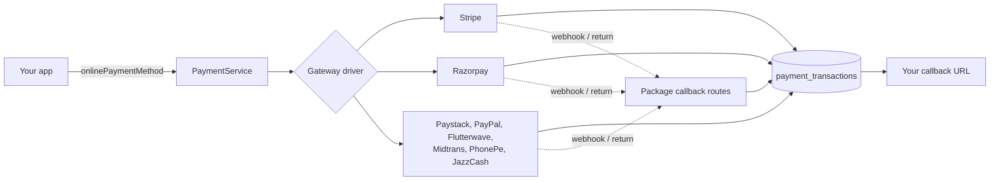

<p align="center">
  
</p>

<h1 align="center">Laravel Payment Gateways</h1>

<p align="center">
  <strong>8 payment gateways. 1 package. One API.</strong><br>
  Add Stripe, Razorpay, Flutterwave, Paystack, PayPal, Midtrans, PhonePe and JazzCash to any Laravel app,<br>
  then let every customer pick the gateway that works in their country.
</p>

<p align="center">
  
  
  
  
  <a href="https://buymeacoffee.com/maheshkerai"></a>
</p>

<p align="center">
  <a href="#-installation">Installation</a> &middot;
  <a href="#-quick-start">Quick start</a> &middot;
  <a href="#-supported-gateways">Gateways</a> &middot;
  <a href="#-configuration">Configuration</a> &middot;
  <a href="#-webhooks">Webhooks</a> &middot;
  <a href="#-extending-the-package">Extend</a> &middot;
  <a href="#-support-the-project">Support</a>
</p>

---

## 💡 Why this package?

Every payment provider has its own SDK, checkout flow, callback format, webhook scheme and status vocabulary. Integrating
three of them means three integrations to build, test and maintain, and your product ends up hard-wired to whichever ones
you managed to finish.

This package puts all of them behind **one API**:

- **Write the integration once.** `onlinePaymentMethod('stripe' | 'razorpay' | 'paystack' | …)` takes the same arguments and returns the same result shape for every gateway.
- **Switch gateways without a deploy.** API keys and the on/off switch live in the database and a built-in admin screen.
- **One transaction log.** Every attempt is stored in `payment_transactions` with the same statuses (`pending`, `success`, `failed`, `refunded`), whichever gateway was used.
- **Ship it in many products.** Install with Composer: the service provider, routes, migrations and views register themselves.
- **Built to grow.** Adding a ninth gateway is one class that implements three methods.

Ideal for SaaS products, multi-tenant platforms, school/ERP/e-commerce scripts and agencies that sell the same
application to customers in different countries, each with a different payment provider.

## 🌍 Supported gateways

| Gateway | Key | Best for | Currency | Customer is sent to | Mode |
|---|---|---|---|---|---|
| **Stripe** | `stripe` | Cards and wallets worldwide | Any currency your Stripe account supports | Stripe Checkout | Follows your API keys (test / live) |
| **Razorpay** | `razorpay` | India: UPI, cards, netbanking, wallets | INR (and others enabled on your account) | Built-in branded payment page and receipt | Follows your API keys |
| **Flutterwave** | `flutterwave` | Africa and international | Currencies enabled on your account | Flutterwave hosted payment page | Follows your API keys |
| **Paystack** | `paystack` | Nigeria, Ghana, South Africa, Kenya | NGN by default; others must be enabled on your Paystack account | Paystack hosted page | Follows your API keys |
| **PayPal** | `paypal` | PayPal balance and cards worldwide | Currencies supported by PayPal | PayPal approval page | `PAYPAL_MODE` |
| **Midtrans** | `midtrans` | Indonesia | IDR | Midtrans Snap page | `MIDTRANS_MODE` |
| **PhonePe** | `phonepe` | India: UPI | INR | PhonePe checkout page | `PHONEPE_MODE` |
| **JazzCash** | `jazzcash` | Pakistan: mobile wallet and cards | PKR | JazzCash hosted page (signed form post) | `JAZZCASH_MODE` |

## ✨ Features

- **Unified API**: a service class (`PaymentService`) and helper functions (`onlinePaymentMethod()`, `verifyPayment()`).
- **Consistent results**: `['success' => true, 'transaction_id' => …, 'order_id' => …, 'payment_data' => […]]` or `['success' => false, 'message' => …]`.
- **Database-driven configuration** plus an **admin screen** to enter keys, enable or disable each gateway and see its webhook URL.
- **Transaction log** with an Eloquent model (`PaymentTransaction`) and helpers such as `isSuccessful()`.
- **Webhook endpoint** for every gateway at `/payment-gateways/webhooks/{gateway}`.
- **Branded Razorpay payment page and success receipt** that show your system name, logo and product details (see [below](#-razorpay-payment-page-and-receipt)).
- **Safe state changes**: a finished transaction is never overwritten by a later verification call.
- **Duplicate-click protection** for Stripe and Razorpay: repeat attempts within 30 seconds reuse the pending transaction.
- **Laravel 9 to 13**, PHP 8.0+, publishable config and views.
- **Extensible** with your own gateways.



## 📦 Requirements

- PHP **8.0+** with the `curl` and `json` extensions
- Laravel **9, 10, 11, 12 or 13**
- A database (MySQL, MariaDB, PostgreSQL, SQLite)
- **PhonePe only:** PhonePe's PHP SDK, which PhonePe distributes outside Packagist (see [step 1](#1-install))

## 🚀 Installation

### 1. Install

```bash
composer require mahesh-kerai/payment-gateways
```

If you received the package as a folder or zip instead of from a repository, point Composer at it:

```json
"repositories": [
    { "type": "path", "url": "packages/mahesh-kerai/payment-gateways", "options": { "symlink": true } }
]
```

```bash
composer require "mahesh-kerai/payment-gateways:*@dev"
```

The service provider is discovered automatically.

<details>
<summary><strong>Using PhonePe? Add its SDK (one-time)</strong></summary>

PhonePe publishes its PHP SDK as a download, not on Packagist. Add this to your application's `composer.json`
and require it:

```json
"repositories": [
    {
        "type": "package",
        "package": {
            "name": "phonepe/pg-php-sdk-v2",
            "version": "2.0.0",
            "dist": {
                "url": "https://phonepe.mycloudrepo.io/public/repositories/phonepe-pg-php-sdk/v2-sdk.zip",
                "type": "zip"
            },
            "autoload": { "classmap": ["/"] },
            "require": { "php": "^8.0", "vlucas/phpdotenv": "^5.5", "netresearch/jsonmapper": "^4.4" }
        }
    }
]
```

```bash
composer require phonepe/pg-php-sdk-v2:^2.0
```

All other gateways work without extra packages.
</details>

### 2. Create the tables

```bash
php artisan migrate
```

This creates `payment_gateways` and `payment_transactions`.

### 3. Add the gateways

```bash
php artisan db:seed --class="MaheshKerai\PaymentGateways\Database\Seeders\PaymentGatewaysSeeder"
```

This creates one **inactive** row per gateway. It is safe to run again later: it only refreshes webhook paths and never
touches keys you have saved.

### 4. Enter your keys and activate a gateway

Sign in to your app and open the built-in screen:

```
https://your-app.test/payment-gateways/gateways
```

Pick a gateway, paste its credentials, set **Status** to *Active* and save. Which value goes where:

| Gateway | Publishable key field | Secret key field | Other fields |
|---|---|---|---|
| Stripe | Publishable key | Secret key | Webhook secret |
| Razorpay | Key ID | Secret key | Webhook secret |
| Flutterwave | Public key | Secret key | Webhook secret |
| Paystack | Public key | Secret key | Webhook secret |
| PayPal | Client ID | Secret key | Webhook secret |
| Midtrans | Client key | Server key (secret key field) | n/a |
| PhonePe | Client ID | Client secret | Username and password (webhook authentication) |
| JazzCash | Merchant ID | Integrity salt | Password |

Prefer code? Credentials are ordinary Eloquent rows:

```php
use MaheshKerai\PaymentGateways\Models\PaymentGateway;

PaymentGateway::where('name', 'stripe')->update([
    'publishable_key' => 'pk_live_…',
    'secret_key'      => 'sk_live_…',
    'webhook_secret'  => 'whsec_…',
    'status'          => 1, // 1 = active, 0 = inactive
]);
```

### 5. Optional: publish the config and views

```bash
php artisan vendor:publish --tag=payment-gateways-config
php artisan vendor:publish --tag=payment-gateways-views
```

## ⚡ Quick start

### Charge a customer

```php
use Illuminate\Http\RedirectResponse;

public function pay(Request $request)
{
    $result = onlinePaymentMethod(
        $request->gateway,                  // 'stripe', 'razorpay', 'paystack', 'jazzcash', …
        499.00,                             // amount
        'INR',                              // currency
        route('payment.callback', ['gateway' => $request->gateway]), // where the customer returns to
        [
            'user_id'        => auth()->id(),
            'product_name'   => 'Premium Plan',
            'description'    => 'Annual subscription',
            'customer_name'  => auth()->user()->name,
            'customer_email' => auth()->user()->email,
        ]
    );

    // Razorpay: the helper already returns a redirect to the built-in payment page
    if ($result instanceof RedirectResponse) {
        return $result;
    }

    if (! $result['success']) {
        return back()->with('error', $result['message']);
    }

    // Every other gateway: send the customer to the provider's page
    // (Paystack names it authorization_url; the rest use checkout_url)
    return redirect(
        $result['payment_data']['checkout_url'] ?? $result['payment_data']['authorization_url']
    );
}
```

The same call works for every gateway. A successful result always looks like this:

```php
[
    'success'        => true,
    'transaction_id' => 12,                      // payment_transactions.id
    'order_id'       => 'ORD-AB12CD34EF56-1760000000',
    'payment_data'   => ['checkout_url' => 'https://…'],  // gateway-specific details
]
```

and a failure is always `['success' => false, 'message' => 'Why it failed']`.

### Confirm the payment when the customer comes back

```php
public function callback(Request $request)
{
    $verification = verifyPayment($request->input('gateway'), $request->all());

    if ($verification['success']) {
        // mark the order as paid, send the invoice…
        return redirect()->route('payment.success');
    }

    return redirect()->route('payment.failed')->with('error', $verification['message'] ?? 'Payment failed');
}
```

`verifyPayment()` needs a little data from the gateway's return, and updates the matching `payment_transactions` row for you:

| Gateway | Pass to `verifyPayment()` |
|---|---|
| `stripe` | `session_id` |
| `razorpay` | `razorpay_order_id`, `razorpay_payment_id`, `razorpay_signature` (the package's own callback already does this for you) |
| `flutterwave` | `tx_ref`, `transaction_id` |
| `paystack` | `reference` |
| `paypal` | `token` (the package's `/payment-gateways/paypal/callback` already does this for you) |
| `midtrans` | `order_id` |
| `phonepe` | `order_id` |
| `jazzcash` | `order_id` (the package's own return route already does this for you) |

For gateways that return through the package (Razorpay, PayPal, JazzCash), your `callback_url` receives `order_id`,
`transaction_id`, `payment_id` and `status` (`success` or `failed`) as query parameters, so you can simply read the result:

```php
use MaheshKerai\PaymentGateways\Models\PaymentTransaction;

$transaction = PaymentTransaction::find($request->input('transaction_id'));

if ($transaction?->isSuccessful()) {
    // fulfil the order
}
```

## 🔧 Configuration

**API keys live in the database** (step 4), not in `.env`. The `.env` file only controls the environment of the gateways
that have one, plus the receipt:

```env
PAYPAL_MODE=sandbox                 # sandbox | production
MIDTRANS_MODE=sandbox               # sandbox | production
PHONEPE_MODE=uat                    # uat | production
PHONEPE_CLIENT_VERSION=1
JAZZCASH_MODE=sandbox               # sandbox | production
JAZZCASH_TXN_TYPE=MWALLET           # optional: MWALLET | MIGS | OTC
JAZZCASH_RETURN_URL=                # optional: override JazzCash's return URL, supports {order_id}

PAYMENT_RECEIPT_ENABLED=true        # Razorpay success receipt (false = redirect straight away)
PAYMENT_RECEIPT_REDIRECT_SECONDS=5  # 0 = wait for the customer to press Continue
```

Stripe, Razorpay, Flutterwave and Paystack switch between test and live purely by the keys you enter.

> **Security notes**
> - Gateway keys are stored in plain database columns. Restrict database access and backups accordingly.
> - The management screen (`/payment-gateways/gateways`) only requires a signed-in user. Limit it to administrators in your
>   application, for example with a middleware that checks `request()->is('payment-gateways/gateways*')`.

## 🔔 Webhooks

Every gateway posts to one route:

```
https://your-app.test/payment-gateways/webhooks/{gateway}
```

For example `…/webhooks/stripe`, `…/webhooks/razorpay`, `…/webhooks/jazzcash`. The matching URL is shown on each
gateway's page in the admin screen. The endpoint updates the transaction when the provider confirms or declines a payment.

**Exclude the route from CSRF protection**, because providers cannot send a CSRF token:

```php
// Laravel 9 / 10: app/Http/Middleware/VerifyCsrfToken.php
protected $except = [
    'payment-gateways/webhooks/*',
];
```

```php
// Laravel 11 / 12 / 13: bootstrap/app.php
->withMiddleware(function (Middleware $middleware) {
    $middleware->validateCsrfTokens(except: ['payment-gateways/webhooks/*']);
})
```

Webhooks are optional for gateways that confirm the payment when the customer returns, and the recommended way to
confirm payments for PhonePe and Midtrans.

## 🧾 Razorpay payment page and receipt

Razorpay opens on a branded, responsive payment page (it follows the visitor's light or dark preference) that shows your
system name and logo, an order summary, the amount, order and transaction IDs, the date and a *Secured by Razorpay* badge.
After the payment is **verified**, a receipt with a clear *Payment successful* status is shown and then continues to your
callback URL on its own.

Everything comes from the metadata you pass; nothing is hardcoded:

| Metadata key | Shown as |
|---|---|
| `merchant_name` | System name (defaults to `config('app.name')`) |
| `merchant_logo` | Logo: an `http(s)` URL or a site-relative path such as `/assets/logo.svg` (a letter avatar is used without one) |
| `product_name`, `description`, `product_image` | Order summary |
| `customer_name`, `customer_email` | Customer rows (also prefill Razorpay's checkout, together with `customer_phone`) |
| `theme_color`, `button_text` | Accent colour (hex) and button label |
| any other plain value, e.g. `billing_cycle` | An extra labelled row ("Billing Cycle") |

```php
return onlinePaymentMethod('razorpay', 1500, 'INR', route('payment.callback'), [
    'merchant_name'  => 'eSchool saas',
    'merchant_logo'  => asset('assets/logo.svg'),
    'product_name'   => 'Premium Plan - Annual',
    'description'    => 'Unlimited students and online exams',
    'billing_cycle'  => 'Yearly',
    'customer_name'  => auth()->user()->name,
    'customer_email' => auth()->user()->email,
]);
```

Values are shown as plain text only (escaped, shortened, at most 8 extra rows). Unsafe logo URLs and non-hex colours are
ignored, and keys that look like secrets (`api_key`, `password`, `token`, `card`, …) or internal keys (`user_id`,
`callback_url`, …) are never displayed. The amount, currency and IDs on the receipt come from Razorpay and your database,
not from the request. To restyle the pages, publish the views and edit `razorpay-checkout.blade.php`,
`razorpay-receipt.blade.php` and the `partials/` they share.

## 🇵🇰 JazzCash

<details>
<summary><strong>How the JazzCash integration works</strong></summary>

JazzCash (Page Redirection / HTTP POST) is implemented inside this package and needs no extra Composer dependency.
Currency is **PKR** only.

```php
$result = onlinePaymentMethod('jazzcash', 1500.00, 'PKR', route('payment.callback'), [
    'user_id'      => auth()->id(),
    'product_name' => 'Subscription',
]);

return redirect($result['payment_data']['checkout_url']); // auto-submits the signed JazzCash form
```

1. `checkout_url` is a signed, 30-minute link that posts the form to JazzCash, including `pp_SecureHash`
   (HMAC-SHA256 with your integrity salt over the sorted, non-empty `pp_` / `ppmpf_` values).
2. JazzCash posts the result to `pp_ReturnURL`, which defaults to `/payment-gateways/jazzcash/callback/{orderId}`.
3. The callback recomputes the secure hash and checks the response belongs to that order. **A payload whose hash does not
   verify is rejected and the transaction is left untouched.** A verified payload updates the transaction and the browser
   is sent to your callback URL with `order_id`, `transaction_id`, `payment_id` and `status`.

`verifyPayment('jazzcash', ['order_id' => $orderId])` asks JazzCash's Payment Inquiry API. The JazzCash IPN URL is
`https://your-app.test/payment-gateways/webhooks/jazzcash`. Refunds are not part of the gateway contract.
</details>

## 🗂 Transactions and helpers

```php
use MaheshKerai\PaymentGateways\Models\PaymentTransaction;

$paid = PaymentTransaction::where('user_id', auth()->id())
    ->where('status', 'success')
    ->latest()
    ->get();

$transaction = getTransactionByOrderId($orderId);   // with its gateway and user loaded

$transaction->isSuccessful();   // also isPending(), isFailed()
```

| Helper | What it does |
|---|---|
| `onlinePaymentMethod($gateway, $amount, $currency, $callbackUrl, $metadata = [])` | Starts a payment (Razorpay returns a redirect) |
| `verifyPayment($gateway, $data)` | Verifies a payment and updates its transaction |
| `getTransactionByOrderId($orderId)` | Finds a transaction with its gateway and user |
| `getPaymentCallbackUrl()` | The package's unified callback URL |
| `getRazorpayFormUrl($amount, $currency, $callbackUrl, $options)` | URL of the Razorpay payment page |

The class behind them is `MaheshKerai\PaymentGateways\Services\PaymentService` if you prefer dependency injection.

## 🗄 Database

**`payment_gateways`**: one row per gateway.

| Column | Type | Description |
|---|---|---|
| `id` | bigint | Primary key |
| `name` | string, unique | Gateway key (`stripe`, `razorpay`, …) |
| `secret_key` | text | Secret key |
| `publishable_key` | text | Public key / client ID / merchant ID |
| `webhook_secret` | text | Webhook secret |
| `username`, `password` | string | Extra credentials (PhonePe, JazzCash) |
| `webhook_url` | string | Webhook path |
| `status` | tinyint | `1` active, `0` inactive (default `0`) |

**`payment_transactions`**: one row per payment attempt.

| Column | Type | Description |
|---|---|---|
| `id` | bigint | Primary key |
| `user_id` | bigint, nullable | Your user |
| `payment_gateway_id` | bigint | Foreign key to `payment_gateways` |
| `amount` | decimal(10,2) | Amount |
| `order_id` | string, unique | The package's order reference |
| `payment_id` | string, nullable | The provider's payment ID (filled in as the payment progresses) |
| `payment_signature` | string, nullable | Provider signature, where one exists |
| `status` | enum | `pending`, `success`, `failed`, `refunded` |

## 🧩 Extending the package

Add a gateway by writing one class and registering it.

```php
namespace MaheshKerai\PaymentGateways\Gateways;

final class AcmePayGateway extends BaseGateway
{
    public function initializePayment(float $amount, string $currency, string $orderId, array $metadata = []): array
    {
        // Call the provider; return ['payment_id' => …, 'checkout_url' => …]
        // Credentials: $this->getConfigValue('secret_key'), ('publishable_key'), ('webhook_secret')
    }

    public function verifyPayment(array $data): array
    {
        // return ['success' => true, 'payment_id' => …, 'amount' => …] or ['success' => false, 'message' => …]
    }

    public function handleWebhook(array $payload): array
    {
        // return ['success' => true, 'order_id' => …, 'payment_id' => …] or ['success' => false, …]
    }
}
```

Then register the key `acmepay` in each place that lists gateways:

1. `src/PaymentGatewaysServiceProvider.php`: the container bindings
2. `src/Services/PaymentService.php`: `resolveGateway()`
3. `src/Http/Controllers/WebhookController.php`: `resolveGateway()`
4. `src/Http/Controllers/PaymentGatewayController.php`: the gateway list in the admin screen
5. `database/seeders/PaymentGatewaysSeeder.php`: the seeded rows
6. `config/payment-gateways.php`: the credential fields the admin screen should show

## 🧪 Development

```bash
composer install
vendor/bin/phpunit
```

The suite uses PHPUnit with Orchestra Testbench.

## ☕ Support the project

If this package saves you time, you can support its development:

<p>
  <a href="https://buymeacoffee.com/maheshkerai">
    
  </a>
</p>

[buymeacoffee.com/maheshkerai](https://buymeacoffee.com/maheshkerai)

## 📄 License

Released under the [MIT License](LICENSE).

Made with ❤️ by [Mahesh Kerai](https://buymeacoffee.com/maheshkerai).
